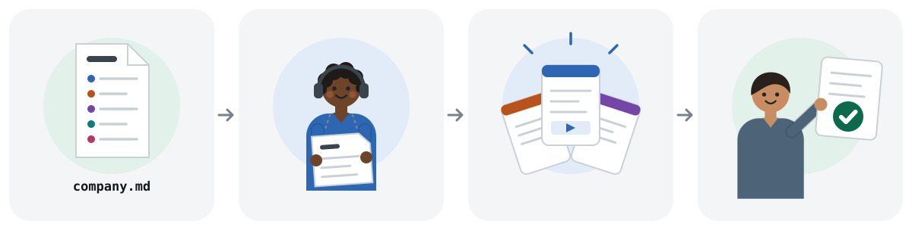

<p align="center">
  
</p>

<h1 align="center">agent-factory</h1>

<p align="center">Specialist agents for company work, one per department. Each reads your company profile first and brings you anything that leaves the company.</p>

<p align="center">
  <a href="https://github.com/rishabh0111/agent-factory/actions/workflows/check.yml"></a>
  <a href="LICENSE"></a>
  <a href="https://rishabh0111.github.io/agent-factory/"></a>
  
</p>

> **Quick start:** In Claude Code 2.1.275 or later, install `af-core` and one department, run `/af-setup` in your repository, then ask for a specialist by role: "have the legal specialist triage this NDA". Not sure who handles a task? Run `/af-ask`. More at [rishabh0111.github.io/agent-factory](https://rishabh0111.github.io/agent-factory/).

## Why

A general-purpose agent asked to do company work tends to go wrong in familiar ways:

- The sales email it drafts uses a voice that is not yours, for a product you do not sell.
- It quotes a refund policy or contract position your company never agreed to.
- It treats a contract review or a month-end close as a writing exercise, with no checklist behind it.
- It sends, signs, pays or publishes before anyone has looked.

agent-factory starts from your company. `/af-setup` writes `company.md` with you (products, customers, voice, policies, limits, systems, glossary) and imports it into the project `CLAUDE.md`, so every session, specialist and skill reads it. Each department is a plugin with one specialist and that department's skills. Specialists research, analyse and draft on their own, and bring anything sent, signed, paid, filed or published to a person first.

## Meet the team

<!-- team-grid:start -->
12 departments, each a plugin with one specialist and its skills.

<table>
<tr>
<td align="center" valign="top" width="33%"><br><a href="plugins/af-customer-support"><b>Support</b></a><br><sub>Triages tickets, drafts replies, writes help articles.</sub><br><code>af-customer-support</code></td>
<td align="center" valign="top" width="33%"><br><a href="plugins/af-sales"><b>Sales</b></a><br><sub>Researches accounts, preps calls, drafts outreach, forecasts.</sub><br><code>af-sales</code></td>
<td align="center" valign="top" width="33%"><br><a href="plugins/af-finance"><b>Finance</b></a><br><sub>Journal entries, reconciliations, month-end close, variance.</sub><br><code>af-finance</code></td>
</tr>
<tr>
<td align="center" valign="top" width="33%"><br><a href="plugins/af-legal"><b>Legal</b></a><br><sub>Contracts, NDAs, privacy policies, compliance risk.</sub><br><code>af-legal</code></td>
<td align="center" valign="top" width="33%"><br><a href="plugins/af-human-resources"><b>HR</b></a><br><sub>Offers, interview plans, onboarding, reviews, pay.</sub><br><code>af-human-resources</code></td>
<td align="center" valign="top" width="33%"><br><a href="plugins/af-operations"><b>Operations</b></a><br><sub>Process docs, runbooks, change requests, vendor reviews.</sub><br><code>af-operations</code></td>
</tr>
<tr>
<td align="center" valign="top" width="33%"><br><a href="plugins/af-data"><b>Data</b></a><br><sub>Explores data, writes SQL, reads A/B tests and cohorts.</sub><br><code>af-data</code></td>
<td align="center" valign="top" width="33%"><br><a href="plugins/af-design"><b>Design</b></a><br><sub>Critiques designs, checks accessibility, writes UX copy.</sub><br><code>af-design</code></td>
<td align="center" valign="top" width="33%"><br><a href="plugins/af-product-management"><b>Product</b></a><br><sub>Discovery, strategy, specs, roadmaps and sprints.</sub><br><code>af-product-management</code></td>
</tr>
<tr>
<td align="center" valign="top" width="33%"><br><a href="plugins/af-marketing"><b>Marketing</b></a><br><sub>Positioning, GTM, copy, SEO, ads and launches.</sub><br><code>af-marketing</code></td>
<td align="center" valign="top" width="33%"><br><a href="plugins/af-leadership"><b>CEO advisor</b></a><br><sub>Reviews strategy, scope and plans before you commit.</sub><br><code>af-leadership</code></td>
<td align="center" valign="top" width="33%"><br><a href="plugins/af-small-business"><b>Small business</b></a><br><sub>Invoices, payroll, cash flow, pipeline and support.</sub><br><code>af-small-business</code></td>
</tr>
</table>
<!-- team-grid:end -->

<details>
<summary>The same team as a table, with each specialist's agent name</summary>

<!-- team:start -->
| Plugin | Specialist | Works on |
|---|---|---|
| `af-customer-support` | support-specialist | Triages tickets, drafts replies, writes help articles. |
| `af-sales` | sales-specialist | Researches accounts, preps calls, drafts outreach, forecasts. |
| `af-finance` | finance-specialist | Journal entries, reconciliations, month-end close, variance. |
| `af-legal` | legal-specialist | Contracts, NDAs, privacy policies, compliance risk. |
| `af-human-resources` | hr-specialist | Offers, interview plans, onboarding, reviews, pay. |
| `af-operations` | ops-specialist | Process docs, runbooks, change requests, vendor reviews. |
| `af-data` | data-specialist | Explores data, writes SQL, reads A/B tests and cohorts. |
| `af-design` | design-specialist | Critiques designs, checks accessibility, writes UX copy. |
| `af-product-management` | product-specialist | Discovery, strategy, specs, roadmaps and sprints. |
| `af-marketing` | marketing-specialist | Positioning, GTM, copy, SEO, ads and launches. |
| `af-leadership` | ceo-advisor | Reviews strategy, scope and plans before you commit. |
| `af-small-business` | small-business-specialist | Invoices, payroll, cash flow, pipeline and support. |
<!-- team:end -->

</details>

## Install

Install the core, then only the departments you use:

```
/plugin install af-core --marketplace rishabh0111/agent-factory
/plugin install af-legal --marketplace rishabh0111/agent-factory
/af-setup
```

Swap `af-legal` for any plugin from [Meet the team](#meet-the-team). Each department's skills apply on their own once it is installed, which is why you install only the ones you need.

<details>
<summary>Skills that read a CRM, ticketing, HR or accounting system</summary>

Those skills expect that system's connector. Each plugin lists the ones it uses in its `CONNECTORS.md`, its bundled `.mcp.json` or, for marketing, `tools/REGISTRY.md`. `/af-ask` names the connector a skill needs.

</details>

## Usage

Ask by role, in plain words:

```text
/af-setup
have the legal specialist triage this NDA before I sign it
ask the sales specialist to prepare my call with Acme tomorrow
have the finance specialist explain why marketing spend ran over budget in March
have the data specialist find which signup channel kept users longest last quarter
/af-ask  who should turn our refund steps into a runbook?
/af-leadership:office-hours     # interviews you, so it runs in the main session
```

Work that spans departments runs one specialist per deliverable: for a launch, Product writes the spec, Marketing the launch plan and Sales the outreach.

## How it works

<p align="center">
  
</p>

1. `company.md` holds one page about your products, customers, voice and limits. `CLAUDE.md` imports it, so it reaches the main session and every subagent.
2. You ask for a specialist by role. It reads `company.md` before it starts.
3. The specialist picks the department skill that fits the task and runs it.
4. It does research, analysis and drafts alone, and stops for a person before anything is sent, signed, paid, filed or published.

Skills that interview you in rounds, such as office hours or onboarding, run in the main session, because a specialist subagent cannot wait for your answers. `/af-ask` tells you which ones they are.

## Commands

`af-core` holds the commands that set up and route the team:

<!-- core:start -->
| Command | What it does |
|---|---|
| `/af-add-specialist` | Add a new specialist department to agent-factory, or add skills to an existing one. |
| `/af-ask` | Ask which specialist and which skill fit a company task. |
| `/af-setup` | Set up company.md and load it into every session, specialist and department skill. |
<!-- core:end -->

## Common questions

**Do I need every plugin?**
No. Install `af-core` and the departments you use. Each department's skills apply on their own once installed, so extra departments add skills you may not want.

**What runs on its own?**
Department skills load when a task matches them, and a specialist runs them when you ask by role. The `af-core` commands and the interview skills wait until you type them.

**Is anything sent automatically?**
No. Specialists research, analyse and draft alone. Anything sent, signed, paid, filed or published comes to a person first, and at each hand-off between departments where something leaves the company.

**Does it work with other agents that read SKILL.md?**
The department skills are plain `SKILL.md` folders under `plugins/<plugin>/skills/`, and `company.md` is ordinary Markdown, so another agent can use both. The specialists are Claude Code subagents, and the install commands are Claude Code features.

**Does it work on Windows?**
Yes. Most skills are instructions only. A few ship Python scripts, which need Python installed.

**How do updates from upstream work?**
Most department skills began as open-source skills by other authors. [UPSTREAM.md](UPSTREAM.md) records the source repository, the commit copied and the paths for each one. `scripts/upstream-diff.sh <path-to-upstream-clone>` lists the upstream commits since then that touch those paths, and fixes are ported by hand.

## Related

- [software-factory](https://github.com/rishabh0111/software-factory): skills that take software from an idea to a reviewed, verified, shipped change. Engineering work goes there.
- [skills](https://github.com/rishabh0111/skills): general-purpose skills for thinking, writing and research.

## Contributing

Run `/af-add-specialist` from this repository to add a department. It creates the plugin, the specialist and its skills, registers the plugin in the marketplace, adds an entry to `docs/team.json` and runs the checks. A department without its own illustration in `docs/assets/` gets a default portrait.

After any change to `docs/team.json` or a skill, run:

```
node scripts/build-site.mjs
```

That regenerates the website's team grid, the team and command tables in this README, each plugin's skill table and the `af-ask` catalog. CI runs `node scripts/build-site.mjs --check` and `claude plugin validate . --strict`, and fails when either is out of date.

## License

[MIT](LICENSE) for this repository's own files. Bundled content keeps its own licence, which sits beside it: each plugin folder holds the licence files for its skills. [UPSTREAM.md](UPSTREAM.md) lists the source of every skill and command.
